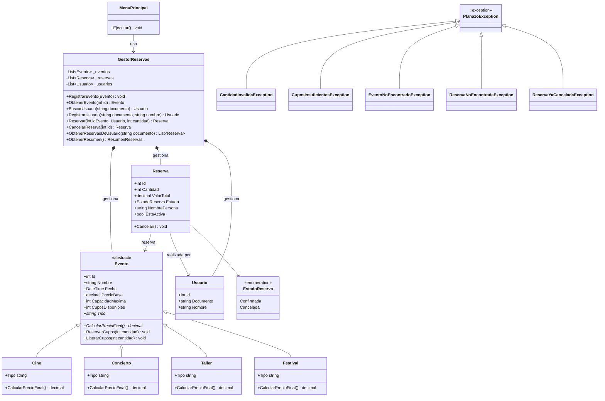
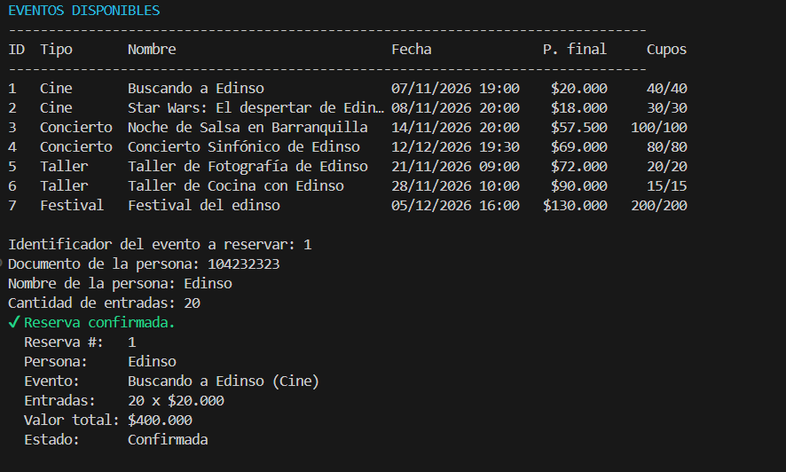
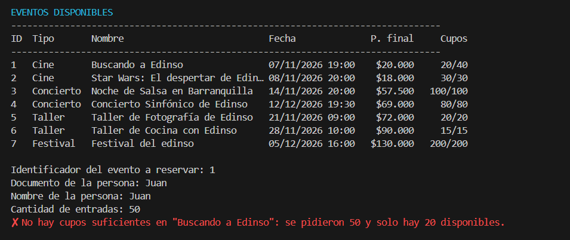
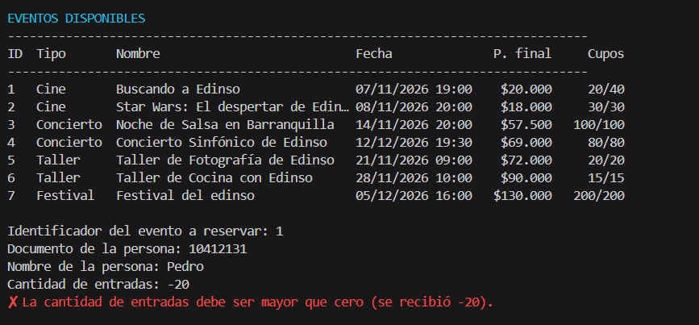
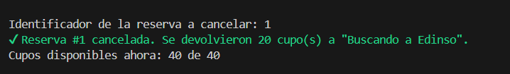

# PLANAZO — Sistema de reservas de eventos (POO en C#)

**Asignatura:** Programación con C# y .NET · **Tipo:** aplicación de consola · **Modalidad:** individual
**Autor:** Edinso · **Framework:** .NET 8

## 1. Descripción de la aplicación

PLANAZO es una empresa que organiza conciertos, funciones de cine y talleres. Esta aplicación de consola permite
**consultar eventos, reservar entradas, controlar los cupos disponibles y cancelar reservas**, aplicando los principios
de Programación Orientada a Objetos: clases, constructores, encapsulamiento, herencia, abstracción, polimorfismo,
composición, colecciones (`List<T>`) y excepciones.

## 2. Funcionalidades implementadas

| Opción | Funcionalidad                                                               |
| :----: | --------------------------------------------------------------------------- |
|   1    | Ver eventos disponibles (tipo, fecha, precio final y cupos)                 |
|   2    | Consultar el detalle de un evento por su identificador                      |
|   3    | Reservar entradas (con todas las validaciones)                              |
|   4    | Ver todas las reservas realizadas                                           |
|   5    | Cancelar una reserva (devuelve los cupos)                                   |
|   6    | Resumen: reservas activas, entradas reservadas y valor total de las activas |
|   7    | **Reto 2:** ver las reservas de un usuario                                  |
|   8    | Ejecutar los 7 casos de prueba del parcial de forma demostrativa            |
|   0    | Salir                                                                       |

**Reglas de negocio:**

1. No se permiten reservas con cantidades negativas o iguales a cero.
2. No se puede reservar más entradas que los cupos disponibles.
3. Los cupos disminuyen al confirmar una reserva.
4. Los cupos se devuelven al cancelar una reserva.
5. Una misma reserva no puede cancelarse dos veces.

El programa arranca con **7 eventos**: 2 de cine, 2 conciertos, 2 talleres y 1 festival (Reto 1).
Los valores monetarios usan `decimal`. Ninguna operación incorrecta cierra el programa: todo error se captura y se informa.

## 3. Cómo ejecutar el proyecto

Requisito: [.NET SDK 8.0](https://dotnet.microsoft.com/download) o superior.

```bash
git clone https://github.com/<tu-usuario>/PLANAZO-POO-CSharp.git
cd PLANAZO-POO-CSharp
dotnet run
```

## 4. Estructura del proyecto

```text
PLANAZO-POO-CSharp/
├── Program.cs                      # Punto de entrada (solo arma el gestor y el menú)
├── Planazo.csproj
├── Modelos/
│   ├── Evento.cs                   # Clase abstracta base
│   ├── Cine.cs                     # Precio = precio base
│   ├── Concierto.cs                # Precio = base + 15 %
│   ├── Taller.cs                   # Precio = base - 10 %
│   ├── Festival.cs                 # Reto 1: base + 20 % + $10.000
│   ├── Usuario.cs                  # Reto 2
│   ├── Reserva.cs
│   ├── EstadoReserva.cs            # enum Confirmada / Cancelada
│   └── ResumenReservas.cs          # record con los datos del resumen
├── Servicios/
│   ├── GestorReservas.cs           # Reglas de negocio y colecciones List<T>
│   └── DatosIniciales.cs           # Eventos con los que arranca el programa
├── Excepciones/                    # Excepciones propias del dominio
│   ├── PlanazoException.cs         # Base
│   ├── CantidadInvalidaException.cs
│   ├── CuposInsuficientesException.cs
│   ├── EventoNoEncontradoException.cs
│   ├── ReservaNoEncontradaException.cs
│   └── ReservaYaCanceladaException.cs
├── Presentacion/                   # Interfaz de consola (sin reglas de negocio)
│   ├── MenuPrincipal.cs
│   ├── PruebasDemostrativas.cs
│   ├── Consola.cs
│   └── Formato.cs
├── Capturas/
├── README.md
└── .gitignore
```

La lógica **no** está en `Program.cs`: el código se separa en modelos (qué es cada cosa), servicios (qué reglas se aplican),
excepciones (qué errores pueden ocurrir) y presentación (cómo se muestra y se pide la información).

## 5. Clases desarrolladas y cómo se relacionan

- **`Evento` (abstracta):** identificador, nombre, fecha, precio base, capacidad máxima y cupos disponibles. Declara el
  método abstracto `CalcularPrecioFinal()` y administra los cupos con `ReservarCupos` y `LiberarCupos`.
- **`Cine`, `Concierto`, `Taller`, `Festival`:** heredan de `Evento` e implementan cada una su regla de precio.
- **`Usuario`:** persona que reserva (identificador, documento y nombre).
- **`Reserva`:** asocia un `Usuario` con un `Evento`. Guarda cantidad, valor total y estado (`EstadoReserva`). Sabe cancelarse a sí misma.
- **`GestorReservas`:** contiene las listas `List<Evento>`, `List<Reserva>` y `List<Usuario>` (**composición**: el gestor
  es dueño de esas colecciones) y coordina las operaciones.
- **`MenuPrincipal`:** interfaz de consola; solo pide datos y delega en el gestor.

**Relaciones:**

- `Cine`, `Concierto`, `Taller` y `Festival` **heredan** de `Evento`.
- `Reserva` **se asocia** con un `Evento` y un `Usuario` (muchas reservas pueden apuntar al mismo evento o usuario).
- `GestorReservas` **compone** colecciones de eventos, reservas y usuarios.
- `MenuPrincipal` **usa** al `GestorReservas`.

### Diagrama de clases UML (Reto 3)

Un diagrama de clases UML es un plano que muestra las clases de un sistema, sus atributos, sus métodos y cómo se
relacionan (herencia, asociación, composición). GitHub renderiza este diagrama automáticamente:



## 6. Dónde se aplican los conceptos de POO

| Concepto                       | Dónde se aplica                                                                                                                                                                                                                                                                                                  |
| ------------------------------ | ---------------------------------------------------------------------------------------------------------------------------------------------------------------------------------------------------------------------------------------------------------------------------------------------------------------- |
| **Clases y objetos**           | `Evento`, `Reserva`, `Usuario`, `GestorReservas`; en tiempo de ejecución se crean objetos como `new Concierto(3, "Noche de Salsa…", …)`.                                                                                                                                                                         |
| **Constructores**              | Todos los constructores validan los datos (`Evento`, `Usuario`, `Reserva`). Un evento nace con `CuposDisponibles = CapacidadMaxima`. Los hijos llaman a `base(...)`.                                                                                                                                             |
| **Encapsulamiento**            | Las propiedades son de solo lectura (`{ get; }`). `Evento.CuposDisponibles` y `Reserva.Estado` tienen `private set`: solo cambian mediante `ReservarCupos()`, `LiberarCupos()` y `Cancelar()`, que validan antes de modificar. El gestor expone `IReadOnlyList<T>` para que nadie altere las listas desde fuera. |
| **Herencia**                   | `Cine`, `Concierto`, `Taller` y `Festival` heredan los atributos y la gestión de cupos de `Evento`.                                                                                                                                                                                                              |
| **Abstracción**                | `Evento` es `abstract`: no puede instanciarse y obliga a cada hijo a implementar `CalcularPrecioFinal()` y `Tipo`.                                                                                                                                                                                               |
| **Polimorfismo**               | `Reserva` y el menú llaman `evento.CalcularPrecioFinal()` sin saber de qué tipo es; cada objeto responde con su propia regla (57.500 para un concierto de 50.000, 72.000 para un taller de 80.000…).                                                                                                             |
| **Composición y asociaciones** | `GestorReservas` compone las colecciones; `Reserva` se asocia con `Evento` y `Usuario`.                                                                                                                                                                                                                          |
| **Colecciones**                | `List<Evento>`, `List<Reserva>`, `List<Usuario>` en `GestorReservas`, consultadas con LINQ (`Where`, `FirstOrDefault`, `Sum`).                                                                                                                                                                                   |
| **Excepciones**                | Jerarquía propia desde `PlanazoException`; el menú captura los errores, informa y continúa. Las entradas no numéricas se controlan con `int.TryParse`.                                                                                                                                                           |

## 7. Casos de prueba

Todos se pueden ejecutar de una vez con la **opción 8** del menú. La salida real está en
[`Capturas/salida-casos-de-prueba.txt`](Capturas/salida-casos-de-prueba.txt) y la de una sesión interactiva en
[`Capturas/salida-sesion-interactiva.txt`](Capturas/salida-sesion-interactiva.txt).

| #   | Caso                                | Resultado esperado                                                                                          | Evidencia                                                  |
| --- | ----------------------------------- | ----------------------------------------------------------------------------------------------------------- | ---------------------------------------------------------- |
| 1   | Registrar una reserva válida        | Reserva confirmada y cupos descontados                                                                      |             |
| 2   | Reservar más entradas que los cupos | `CuposInsuficientesException` controlada                                                                    |  |
| 3   | Reservar una cantidad negativa      | `CantidadInvalidaException` controlada                                                                      |          |
| 4   | Cancelar una reserva                | Se devuelven los cupos                                                                                      |    |
| 5   | Cancelar dos veces la misma reserva | `ReservaYaCanceladaException` controlada                                                                    |         |
| 6   | Consultar un evento inexistente     | `EventoNoEncontradoException` controlada                                                                    |         |


## 8. Retos adicionales

- **Reto 1 — Nuevo tipo de evento:** `Festival` (`Modelos/Festival.cs`) calcula `base + 20 % + $10.000` de cargo por servicios.
  Se integró sin modificar `Cine`, `Concierto`, `Taller` ni `GestorReservas`.
- **Reto 2 — Gestión de usuarios:** clase `Usuario`, identificada por documento. Cada `Reserva` pertenece a un usuario
  y la opción 7 del menú muestra todas las reservas de un usuario.
- **Reto 3 — Diagrama UML:** incluido en la sección 5.

## 9. Pregunta de sustentación

> **¿Por qué utilizaste una clase abstracta `Evento` en lugar de crear clases completamente independientes para Cine, Concierto y Taller? ¿Qué ventajas tiene esta decisión cuando necesitamos agregar un nuevo tipo de evento?**

Cine, Concierto y Taller **son** eventos: comparten los mismos datos (identificador, nombre, fecha, precio base,
capacidad y cupos) y el mismo comportamiento de cupos. Lo único que cambia es **cómo se calcula el precio final**. Por eso
puse todo lo común en la clase abstracta `Evento` y dejé solo lo diferente en las hijas, con `CalcularPrecioFinal()`
como método abstracto:

```csharp

public abstract decimal CalcularPrecioFinal();

public void ReservarCupos(int cantidad)
{
    if (cantidad <= 0) throw new CantidadInvalidaException(cantidad);
    if (cantidad > CuposDisponibles) throw new CuposInsuficientesException(Nombre, cantidad, CuposDisponibles);
    CuposDisponibles -= cantidad;
}

// Concierto.cs: solo cambia la regla de precio
public override decimal CalcularPrecioFinal() => PrecioBase * (1 + Recargo);
```

Si hubiera creado tres clases independientes habría tenido que **copiar** los atributos y la lógica de cupos tres veces
(y corregir cada error tres veces). Además, `Reserva` y `GestorReservas` tendrían que conocer cada clase por separado:
una `List<Cine>`, una `List<Concierto>`, una `List<Taller>`, y un `if` por tipo para calcular precios.

**Ventajas al agregar un nuevo tipo de evento:**

1. **Solo se crea una clase nueva.** Al agregar `Festival` bastó con heredar de `Evento` e implementar `CalcularPrecioFinal()`.
2. **No se modifica el código existente** (principio abierto/cerrado): `Cine`, `Concierto`, `Taller`, `Reserva`
   y `GestorReservas` quedaron intactos.
3. **Polimorfismo:** `GestorReservas` guarda todo en una sola `List<Evento>` y `Reserva` calcula
   `evento.CalcularPrecioFinal() * cantidad` sin saber el tipo concreto. El `Festival` funcionó en el menú, las
   reservas y el resumen sin cambiar una sola línea.
4. **El compilador obliga a cumplir el contrato:** al ser abstracto, ningún tipo nuevo puede olvidarse de definir su precio.
5. **Menos errores y mantenimiento más simple:** una corrección en `ReservarCupos()` se aplica automáticamente a todos los tipos.
